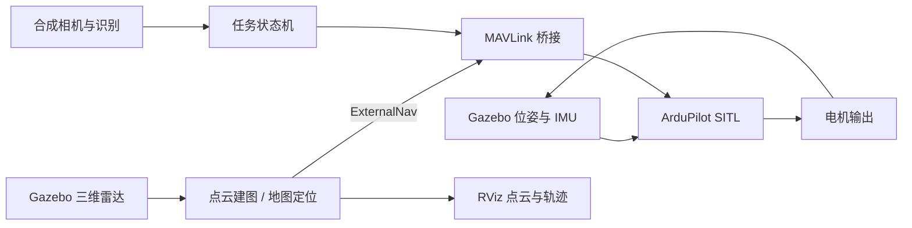

# 架构与接口

## 模块

| 包 | 职责 |
| --- | --- |
| `ap_mission` | 任务状态机、比赛路线和三维制导 |
| `ap_mavlink_bridge` | ROS / MAVLink 消息转换与控制指令 |
| `ap_perception` | 合成相机图像中的地面码、方框和气球识别 |
| `ap_navigation` | 点云匹配、建图/地图定位、地图文件与航点读取 |
| `ap_gazebo_bridge` | 常驻 C++ Gazebo Transport 节点，提供场景位姿/创建/删除服务 |
| `ap_simulation` | Gazebo 世界与模型、模拟传感器、场景和整套启动 |

`ap_simulation` 组合其余包。点云模式从 `ap_navigation/config/competition_waypoints.yaml` 读取地图航点；默认路线保留在 `ap_mission/competition_route.py`。场景标记和无人车终点由原比赛定义提供，编辑航点不会移动场景物体。

## 配置与算法

任务和桥接的通用默认参数分别位于各自包的 `mission_config.py`、`bridge_config.py`；比赛部署覆盖值位于 `src/ap_simulation/config/sim_params.yaml`。SITL 参数位于同目录的 `sitl_params.parm`。

`flight_control_3d.py`、`optical_flow.py`、`optical_flow_odometry.py`、`sensor_math.py` 和 `timebase.py` 不依赖 ROS；节点模块负责消息转换与生命周期。`tests/unit/` 验证独立计算，`tests/ros/` 验证 ROS 消息与节点行为。

比赛机型由 `models/competition_x500/model.sdf.in` 生成，修改模板后运行 `make model`。模型目录和 launch/config/worlds 均保留在所属 ROS 包内。

图像接收只保留最新帧，识码限速 8Hz、其他识别 10Hz，OpenCV 默认单工作线程。相机发布 15Hz；Qt 相机窗口与 ROS 共享事件循环。小车以 30Hz 发布进度，异步调用常驻场景服务，每个模型最多一个未完成请求，不为每帧启动命令行进程。

小车仍是运动学场景对象。路线通过世界 SDF 中墙体、门柱与车辆完整外廓的碰撞检查，运行时再次检查待设置位姿；服务确认到达后才发布终点就绪。`mission_smoke_monitor.py --check-ugv` 可独立检查 Gazebo 返回的实际车体位置和位移。该实现没有轮式动力学或动态避障。

## 坐标

- 本地导航使用 NED：北、东、下；ArduPilot 机体系为 FRD。
- ROS 机体系采用 FLU：前、左、上；传感器边界负责坐标转换。
- 航点高度向上为正，发送 MAVLink 时转换为向下为正。

## 光流接口

| 话题 | 类型 | 约定 |
| --- | --- | --- |
| `/optical_flow/velocity` | `geometry_msgs/TwistStamped` | 机体系 FLU，m/s |
| `/optical_flow/quality` | `std_msgs/UInt8` | 质量 0–255 |
| `/range/down` | `sensor_msgs/Range` | 下视距离，m |
| `/ap/roll_pitch_yaw` | `geometry_msgs/Vector3` | roll/pitch/yaw，rad |

里程计节点发布 `/odometry/optical_flow` 和 `/odometry/optical_flow_path`。仿真源由 Gazebo 真值生成理想数据，用于验证消息、时间和坐标链路；水平位置为相对积分，会产生漂移。

这些接口用于仿真数据链路；公开仓库不提供实机部署配置。第三方组件与补丁来源见[第三方声明](../THIRD_PARTY_NOTICES.md)。

## 点云导航接口

`ap_navigation` 只订阅点云，不读取 Gazebo 位姿或世界几何。原生模拟雷达通过 `ros_gz_bridge` 提供 `/navigation/lidar/points`。导航输出 `/navigation/map`、`/navigation/cloud_registered`、`/navigation/pose`、`/navigation/path`、`/navigation/status`，并将地图 FLU 位姿转换成 `/ap/external_nav/vision_pose` 的本地 NED 位姿。

建图使用点到平面 ICP 和体素地图；定位只匹配已加载地图。匹配退化、重叠不足、位姿跳变或点云超时会撤销 ready，不用真值兜底。任务节点在点云模式关闭真值监视输入，真值只供独立回归监视器和模拟传感器/物理后端使用。操作见[室内导航](indoor_navigation.md)。

## 路线与本地输出

飞机地图航点在 `src/ap_navigation/config/competition_waypoints.yaml`，单位米，以起飞点为原点，X 前/Y 左/Z 上。无人车路线在 `src/ap_simulation/ap_simulation/competition_paths.py` 的 `UGV_ROUTE_WAYPOINTS`，使用 Gazebo 世界坐标；两者原点不同，修改终点需同时核对任务打击位置。RViz 当前只显示路线。

`tools/workspace_env.sh` 统一确定外部私有目录；`build_workspace.sh` 将 build/install/colcon 日志放入其中，`activate.sh` 加载该安装目录。地图、SITL 状态、识别截图和 ArUco 贴图缓存也使用相同目录。源码仓库仅保留仿真实现、场景资源、测试、公开文档和依赖补丁。
